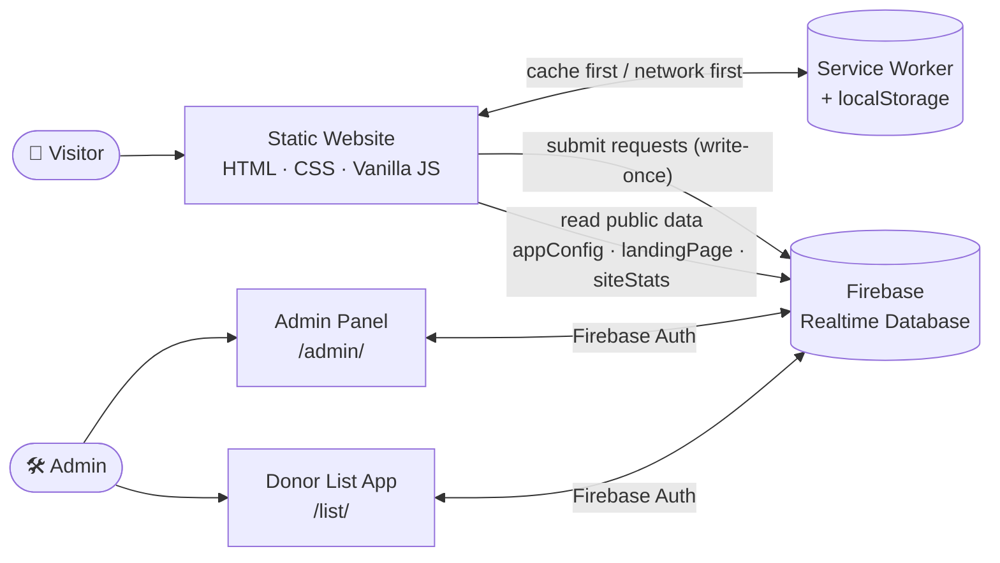

<div align="center">


# Blood Network Baraikhali (B.N.B)

**জরুরি মুহূর্তে বিশ্বস্ত রক্তদাতা খুঁজে পাওয়ার সবচেয়ে সহজ উপায়।**
*The simplest way to find a trusted blood donor in an emergency.*

<br>

[](https://ourbnb.org)
[](#-progressive-web-app)
[](#-architecture)
[](#-bilingual-support)


[**Overview**](#-overview) ·
[**Features**](#-features) ·
[**Pages**](#-pages) ·
[**Architecture**](#-architecture) ·
[**Project Structure**](#-project-structure) ·
[**Getting Started**](#-getting-started) ·
[**Deployment**](#-deployment) ·
[**Security**](#-security--privacy) ·
[**বাংলায় সারসংক্ষেপ**](#-বাংলায়-সারসংক্ষেপ)

</div>

---

## 🩸 Overview

**Blood Network Baraikhali (B.N.B)** is a volunteer blood-donor network serving **Baraikhali, Bangladesh**. The website, hosted at **[ourbnb.org](https://ourbnb.org)**, connects people who urgently need blood with verified donors — **completely free of charge**.

Visitors can:

- 🔎 learn how to find blood or become a donor,
- 🚨 send an **emergency blood request**,
- 🙋 **join the network** as a donor (online form or by phone),
- 📊 browse donation records, hospitals, news and the blood group compatibility chart.

Administrators manage all content, donors and requests through a private **Admin Panel** and a separate **Donor List app**.

> **Design principle:** fast on slow mobile networks, usable offline, and simple enough for anyone to use during an emergency.

---

## ✨ Features

### Public website

| | Feature | Description |
|---|---|---|
| 🚨 | **Emergency blood request** | One form to request blood urgently (blood group, location, contact). Validated on the client **and** by database rules. |
| 🙋 | **Join as donor** | Online application form, or a call-to-join flow for people who prefer to phone. |
| 📈 | **Live statistics** | Donation counters, recent donations and a public-safe `siteStats` summary. |
| 🩸 | **Blood group chart** | Clear A+ / A− / B+ / B− / AB+ / AB− / O+ / O− donor–recipient compatibility chart. |
| 🏥 | **Hospitals & blood banks** | Directory of partner hospitals and blood banks. |
| 📰 | **News** | News posts with detail view and like counter. |
| 🖼️ | **Gallery** | Photo gallery of donation events and activities. |
| 🧾 | **Donation records** | Searchable list (by name, ID or hospital) with blood-group filter. |
| 🤝 | **Partners & sponsors** | Dedicated sections for supporting organisations and sponsors. |
| ❓ | **FAQ** | Frequently asked questions, editable from the Admin Panel. |
| 🔒 | **Privacy policy** | Full 11-section privacy policy in Bangla. |

### Platform capabilities

- 📱 **Progressive Web App** — installable on Android/iOS home screens, with an *"App Download / Open App"* bar.
- 📴 **Offline-ready** — service worker caches the app shell; the site still opens without internet.
- 🌐 **Bilingual** — Bangla (default) with a reversible English layer.
- 🔗 **Clean URLs** — `/how-it-works/`, `/donations/` … with in-app navigation and **no page reload**.
- 🔍 **SEO-ready** — Open Graph, Twitter Card, JSON-LD (`Organization`, `WebSite`), canonical links, `sitemap.xml`, `robots.txt`.
- 🛡️ **Hardened** — strict Content-Security-Policy, referrer policy, locked-down database rules, login rate limiting.
- ⚡ **Bandwidth-saving** — cached Firebase reads with TTL, background-refreshed images, async font loading.

### Admin Panel (`/admin/`)

A private dashboard (Firebase Auth) for non-technical editors:

- Dashboard — website views, monthly donation trend, blood group distribution, top hospitals/locations, recent donations, content summary
- **Emergency notice** banner
- Hero section, *About us*, three feature highlights, impact / CTA band (text **and** background images)
- News, hospitals & blood banks, team members, FAQ, partners, sponsors
- **Page & section ordering** — reorder menu items and home-page sections
- Section titles and short descriptions

### Donor List app (`/list/`)

A separate installable app (own manifest + service worker) for the team:

- Add / view donors and **Donor Profile**
- Add **donation records** and **new blood requests**
- **PDF export** of statements (jsPDF + AutoTable) with *Statement Preview*
- PIN-protected admin login

---

## 📄 Pages

| Route | Folder | Purpose |
|---|---|---|
| `/` | `index.html` | Home — hero, stats, recent donations, about, features, team, FAQ, partners, sponsors, join / emergency forms |
| `/how-it-works/` | `how-it-works/` | Step-by-step guide to find blood or become a donor |
| `/blood-group-chart/` | `blood-group-chart/` | Blood group compatibility chart |
| `/donations/` | `donations/` | All donation records (search + filter) |
| `/news/` | `news/` | News & updates |
| `/hospitals/` | `hospitals/` | Hospitals & blood banks |
| `/gallery/` | `gallery/` | Photo gallery |
| `/about/` | `about/` | About B.N.B, what we do, contact, data correction/removal request |
| `/privacy/` | `privacy/` | Privacy policy |
| `/admin/` | `admin/` | 🔐 Admin Panel (private, not cached, not indexed) |
| `/list/` | `list/` | 🔐 Donor List app (private, own service worker) |
| `/404` | `404.html` | Custom *not found* page |

> All public pages share **one app shell** (`index.html`); the other folders are generated copies with their own `<title>`, description and canonical URL, so each page is crawlable and shareable on its own.

---

## 🏗️ Architecture



### Tech stack

| Layer | Technology |
|---|---|
| Frontend | Plain **HTML5 / CSS3 / vanilla JavaScript** — no framework, no bundler |
| Backend | **Firebase Realtime Database** + **Firebase Authentication** |
| Offline / PWA | Service Worker, Web App Manifest, `localStorage` cache |
| Icons & fonts | Font Awesome 6.5.2, Google Fonts (Noto Sans Bengali, Inter, Fraunces, IBM Plex Mono) |
| PDF export | jsPDF 2.5.1 + jspdf-autotable 3.8.2 (Donor List app) |
| QR codes | api.qrserver.com |
| Tooling | One optional Python 3 script (`_tools/build_pages.py`) |

### Database layout

Access is controlled by `firebase/database.rules.json` (default **deny all**).

| Node | Public can… | Admin can… |
|---|---|---|
| `donors` | ❌ nothing | read / write |
| `donorRequests` | ➕ **create** a new request (validated) | read / edit |
| `emergencyRequests` | ➕ **create** (validated) | read / edit |
| `bloodRequests` | — | read / write |
| `appConfig`, `landingPage` | 👁️ read (site content) | write |
| `siteStats`, `newsLikes` | 👁️ read / limited counters | write |
| `admins`, `adminPresence`, `adminActivity`, `settings` | ❌ | restricted to admins |

---

## 📁 Project structure

```text
ourbnb-site/
├── index.html                 # Main app shell (home + all routes)
├── 404.html                   # Custom not-found page
├── manifest.json              # PWA manifest (name, icons, theme #9E1B32)
├── service-worker.js          # Offline cache for the public site (bnb-v12)
├── sitemap.xml                # Generated by _tools/build_pages.py
├── robots.txt
│
├── how-it-works/index.html    # ┐
├── blood-group-chart/…        # │
├── donations/…                # │  Route pages generated from index.html
├── news/…                     # │  (own title, description, canonical, h1)
├── hospitals/…                # │
├── gallery/…                  # │
├── about/…                    # │
├── privacy/…                  # ┘
│
├── admin/                     # 🔐 Admin Panel
│   ├── index.html
│   ├── admin-logo.png
│   └── admin-icon-192.png
│
├── list/                      # 🔐 Donor List app (own PWA)
│   ├── index.html
│   ├── manifest.json
│   ├── sw.js
│   └── fav.jpeg
│
├── assets/
│   ├── css/style.css          # Entire site stylesheet
│   ├── js/
│   │   ├── app.js             # Main application logic (Firebase, routing, forms, UI)
│   │   ├── i18n.js            # Bangla ⇄ English translation layer
│   │   ├── early.js           # Runs before first paint (legacy #links → clean URLs)
│   │   ├── install-bar.js     # "App Download / Open App" bar
│   │   └── login-guard.js     # Login rate limiter (admin + list)
│   └── images/                # Logo, favicons, PWA icons (192 / 512 / maskable)
│
├── firebase/
│   └── database.rules.json    # Realtime Database security rules
│
└── _tools/
    └── build_pages.py         # Regenerates route pages + sitemap.xml
```

---

## 🚀 Getting started

The site is fully static — **there is no build step and nothing to install** to run it.

### Run locally

```bash
# from the project root, any static server works:
python3 -m http.server 8080
# or
npx serve .
```

Open **http://localhost:8080**.

> ⚠️ Use a local server rather than double-clicking `index.html`: service workers and clean URLs (`/news/`) need `http://`. The site also falls back gracefully when opened via `file://`.

### Connect your own Firebase project

1. Create a project in the [Firebase Console](https://console.firebase.google.com) and enable **Realtime Database** and **Authentication (Email/Password)**.
2. Replace the encoded Firebase web config in `assets/js/app.js` (`_cfgB64`) and in the admin / list pages with your project's config.
3. Deploy the security rules from `firebase/database.rules.json` (see below).
4. Create your admin user, then add their UID under `admins/<uid> = true` in the database.

> The Firebase **web** config is not a secret by design — security comes from the database rules, **App Check** and API-key restrictions (see [Security](#-security--privacy)).

### Regenerate route pages

`index.html` holds the shared navigation, footer and pop-ups. After changing any of those, run:

```bash
python3 _tools/build_pages.py
```

This rebuilds every route page and rewrites `sitemap.xml`. To add a page, add an entry to the `PAGES` dictionary inside the script and run it again.

> Do **not** hand-edit the `data-path`, `data-title`, `data-desc`, `data-desc-en` and `data-h1` attributes — the script sets them.

---

## 🌍 Deployment

Because the site is static, it works on any static host (Firebase Hosting, Cloudflare Pages, Netlify, GitHub Pages, shared hosting, …) with the domain **ourbnb.org**.

**Release checklist**

- [ ] Upload all files, keeping the folder structure
- [ ] Make sure unknown URLs serve `404.html`
- [ ] Publish `firebase/database.rules.json` (Console → Realtime Database → *Rules*, or `firebase deploy --only database`)
- [ ] **Bump `CACHE_VERSION`** in `service-worker.js` (currently `bnb-v12`) so visitors get the new files on their next load
- [ ] Run `python3 _tools/build_pages.py` if navigation/footer changed
- [ ] Submit `https://ourbnb.org/sitemap.xml` to Google Search Console
- [ ] Test on a real phone: install the PWA, go offline, reopen

<details>
<summary><b>How caching works</b></summary>

- **Own HTML / JS / CSS / manifest** → *network-first* (3-second limit), falling back to cache when offline.
- **Own images & icons** → *cache-first*, refreshed in the background (stale-while-revalidate).
- **Fonts, Font Awesome, Firebase SDK** (versioned CDN URLs) → cache-first.
- **Firebase database traffic, non-GET requests, other origins** → never touched.
- **`/admin/` and `/list/`** → never cached by the public worker; `/list/` has its own `sw.js`.

</details>

---

## 🔐 Security & privacy

- **Database rules are deny-by-default.** Donor data (name, mobile, address, blood group) is readable **only by authenticated admins**.
- **Public submissions are write-once and validated** — Bangladeshi mobile format (`01[3-9]XXXXXXXX`), valid blood group, name/address length limits, and `<` `>` rejected to block script injection.
- **Strict Content-Security-Policy** on public pages: no inline scripts, `object-src 'none'`, `frame-ancestors`-style hardening via `base-uri` / `form-action`, HTTPS upgrade.
- **Login guard** on admin & list: minimum gap between attempts, progressive lockout (1 min → 5 min → 15 min → 1 hour) stored across tabs, honeypot field against bots, and a 15-minute lock on Firebase `too-many-requests`.
- **Private areas** (`/admin/`, `/list/`) bypass the public service worker.

**Recommended hardening**

1. Enable **Firebase App Check** (reCAPTCHA) for the Realtime Database.
2. Restrict the Firebase **API key** to `ourbnb.org` in Google Cloud Console.
3. Keep the list of `admins` small and review `adminActivity` regularly.

The browser-side login guard is a convenience layer; real protection comes from Firebase Auth throttling, App Check and the rules above.

**Privacy.** The site collects only the details people choose to submit (for example name, mobile number, address, blood group) plus basic anonymous visit counters. Full details — what is stored, who can see it, retention, user rights and how to request correction or deletion — are in the in-site [Privacy Policy](https://ourbnb.org/privacy/).

---

## 🌐 Bilingual support

The site is **authored in Bangla**. `assets/js/i18n.js` adds a reversible English layer without touching the Bangla source text:

1. **Dictionary** — exact Bangla → English phrases (UI, forms, toasts, defaults).
2. **Patterns** — sentences that embed live data (names, numbers, dates, hospitals).
3. **DOM translator** — walks text nodes and accessibility attributes (`placeholder`, `aria-label`, `title`, …), and SEO descriptions carry `data-en` alternatives.

When adding new Bangla text, add its English equivalent to the dictionary so it translates correctly.

---

## 📱 Progressive Web App

| | |
|---|---|
| **Name** | Blood Network Baraikhali (short name: B.N.B) |
| **Display** | Standalone |
| **Theme colour** | `#9E1B32` (blood red) |
| **Language** | `bn` |
| **Category** | Health, Medical |
| **Icons** | 192 px, 512 px and maskable 512 px |

An install bar at the top of the site shows **"App Download"** (or **"Open App"** when already installed). Dismissing it hides it for 3 days; it never shows inside the installed app.

---

## 🛠️ Maintenance cheat-sheet

| I want to… | Do this |
|---|---|
| Edit text, images, news, FAQ, team, sponsors | Use the **Admin Panel** (`/admin/`) — no code needed |
| Reorder menu / home sections | Admin Panel → *Page & section order* |
| Show an urgent banner | Admin Panel → *Emergency notice* |
| Change navigation / footer / pop-ups | Edit `index.html` → run `python3 _tools/build_pages.py` |
| Change colours / layout | `assets/css/style.css` |
| Push an update to all visitors | Bump `CACHE_VERSION` in `service-worker.js` |
| Add a new public page | Add to `PAGES` in `_tools/build_pages.py` → run it |

---

## 🇧🇩 বাংলায় সারসংক্ষেপ

**Blood Network Baraikhali (B.N.B)** বড়াইখালীর একটি স্বেচ্ছাসেবী রক্তদাতা নেটওয়ার্ক। এই ওয়েবসাইটের মাধ্যমে—

- জরুরি প্রয়োজনে **রক্তের অনুরোধ** পাঠানো যায়,
- **রক্তদাতা হিসেবে যোগ দেওয়া** যায় (অনলাইন ফর্ম বা ফোনে),
- রক্তের গ্রুপ চার্ট, হাসপাতাল তালিকা, সংবাদ, গ্যালারি ও রক্তদানের রেকর্ড দেখা যায়,
- সাইটটি **মোবাইলে অ্যাপের মতো ইনস্টল** করা যায় এবং ইন্টারনেট ছাড়াও খোলে,
- সাইটটি **বাংলা ও ইংরেজি** — দুই ভাষায় চলে।

সম্পূর্ণ সেবা **বিনামূল্যে**। কনটেন্ট, রক্তদাতা ও অনুরোধ ব্যবস্থাপনার জন্য আছে নিরাপদ **অ্যাডমিন প্যানেল** (`/admin/`) এবং **ডোনার লিস্ট অ্যাপ** (`/list/`)। রক্তদাতাদের ব্যক্তিগত তথ্য শুধু অনুমোদিত অ্যাডমিনরাই দেখতে পারেন।

**আপডেট দেওয়ার নিয়ম (সংক্ষেপে):** ফাইল আপলোড করুন → `service-worker.js`-এ `CACHE_VERSION` বাড়ান → দরকার হলে `python3 _tools/build_pages.py` চালান → ফায়ারবেস রুলস পাবলিশ করুন।

---

## 📬 Contact

For donor requests, emergencies, corrections or removal of your data, use the **Contact** section on the [About page](https://ourbnb.org/about/).

---

<div align="center">

**© Blood Network Baraikhali (B.N.B)** — All rights reserved.

*Every drop of blood is the story of a new life.* 🩸

[ourbnb.org](https://ourbnb.org)

</div>
